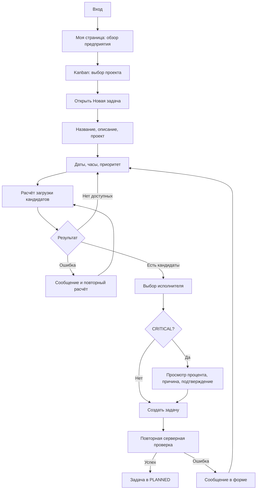
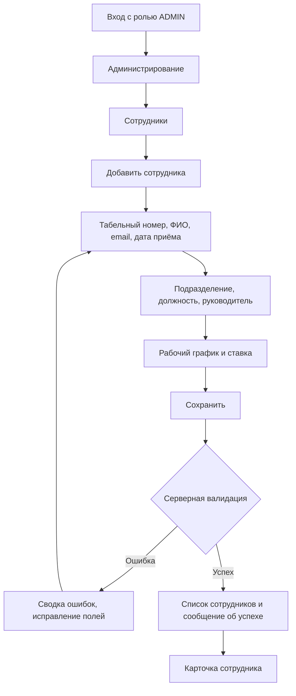
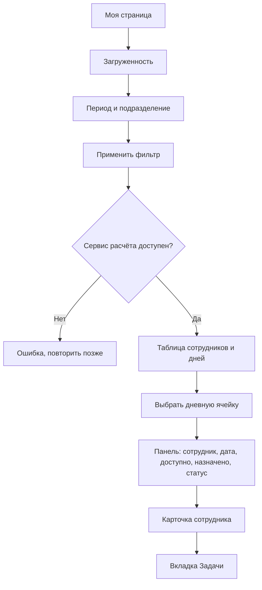

# Пользовательские пути

## 1. Руководитель создаёт задачу

Изменение проекта, дат или часов сбрасывает кандидата и подтверждение критической перегрузки. Устаревший ответ расчёта не может заменить новый. `UNAVAILABLE` недоступен для выбора. Сервер проверяет роль, нагрузку и назначение независимо от интерфейса.

## 2. Администратор создаёт сотрудника

В текущем контракте создания сотрудника нет полей аккаунта и роли. Эти шаги из расширенного задания требуют отдельной реализации backend. Просмотр существующих аккаунтов и ролей находится в разделе «Пользователи» и доступен только ADMIN.

## 3. Руководитель анализирует загрузку

Дневные цифры берутся из результата сервиса. Ссылка в панели открывает выбранного сотрудника; вкладка «Задачи» показывает его назначения. Детальный состав дневного распределения по задачам не возвращается существующим контрактом и не вычисляется заново в браузере.

## Изменение статуса задачи

Перетащить карточку или выбрать статус из списка → при необходимости указать комментарий → PATCH с текущей version → серверная проверка перехода и доступа → обновление колонки и счётчика. При конфликте версии показывается предложение обновить страницу, карточка не перемещается до успешного ответа.

## Поиск и карточка задачи

Поиск в верхней панели → серверный список /tasks → фильтры проекта, статуса, исполнителя текущего аккаунта и просроченности → карточка /tasks/{id}. Карточка показывает описание, даты, часы, исполнителя, автора и проект из базы. Изменение статуса использует тот же API, что доска. Отмена диалога не меняет задачу.
